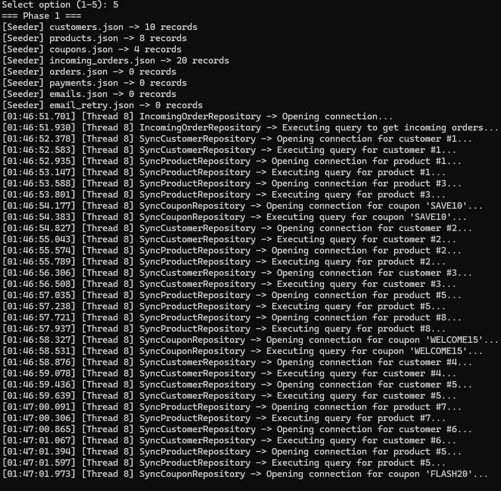

# E-Commerce Order Processing System — File Storage Edition
**Student Name:** Ammar Yasser  
**Group / ID:** G2  
**Framework:** .NET 10 (`net10.0`)

---

## 1. How to Run Each Phase & Project Structure

### Run Commands
The application supports command-line arguments and an interactive numbered menu:

```bash
# Run specific phase
dotnet run --project OrderProcessing -- phase1
dotnet run --project OrderProcessing -- phase2
dotnet run --project OrderProcessing -- phase3
dotnet run --project OrderProcessing -- phase4
dotnet run --project OrderProcessing -- all

# Run with automatic cancellation timeout (e.g. after 4000 ms)
dotnet run --project OrderProcessing -- phase3 --cancel-after 4000

# Without arguments, an interactive numbered menu (1-5) is shown:
dotnet run --project OrderProcessing
```

### Data Folder Location
The data folder is located at:
`Path.Combine(AppContext.BaseDirectory, "Data")`  
(e.g., `OrderProcessing/bin/Debug/net10.0/Data/`).

### Project Structure & Class Roles
```
submission/assignment/06-OrderProcessing/
+-- OrderProcessing/
|   +-- Program.cs                  # Entry point, CLI argument parsing (--cancel-after), menu
|   +-- OrderProcessing.csproj      # Targets net10.0
|   +-- Shared/
|   |   +-- Models/                 # Customer, Product, Order, OrderItem, Coupon, PaymentTransaction, EmailMessage, Report, ShippingQuote
|   |   +-- Storage/
|   |   |   +-- DataFiles.cs        # Static file paths and constants
|   |   |   +-- JsonFileStore.cs    # Thread-safe async/sync file storage with atomic writes and SemaphoreSlim locking
|   |   |   +-- DataSeeder.cs       # Seeds initial JSON files and resets state between phases
|   |   +-- Logging/
|   |   |   +-- Log.cs              # Thread-safe console logging with thread IDs and timestamps
|   |   +-- Exceptions/             # CustomerNotFoundException, DatabaseWriteException, DataFileCorruptedException, InvalidCouponException, ShippingProviderUnavailableException, SmtpUnavailableException
|   +-- Phase1/
|   |   +-- OrderValidator.cs       # Async validation logic
|   |   +-- SyncOrderValidator.cs   # Sync comparison validation logic
|   |   +-- Repositories...         # CustomerRepository, ProductRepository, CouponRepository, OrderRepository, IncomingOrderRepository (+ Sync versions)
|   |   +-- Phase1Runner.cs         # Sequential sync vs async benchmark
|   +-- Phase2/
|   |   +-- PricingService.cs       # SubTotal, discount, and shipping calculations with simulated delays
|   |   +-- OrderPricer.cs          # Compares concurrent vs sequential awaits on Order #1
|   |   +-- RaceConditionDemo.cs    # Demonstrates stock overselling (unsafe) vs safe reservation
|   |   +-- BlockingWaitDemo.cs     # Dedicated demo showing dangers of .Result / .Wait()
|   |   +-- OrderProcessorV2.cs     # Concurrent order processor
|   |   +-- InvoiceGenerator.cs     # Task.Run CPU-bound simulation generating invoice txt files
|   |   +-- ReportGenerator.cs      # Loads data concurrently and creates report_{timestamp}.json
|   |   +-- Phase2Runner.cs         # Coordinates Phase 2 workflow
|   +-- Phase3/
|   |   +-- CustomerService.cs      # Customer loading with CustomerNotFoundException
|   |   +-- InventoryService.cs     # Atomic all-or-nothing stock reservation and release
|   |   +-- IPaymentGateway.cs      # Payment gateway contract
|   |   +-- PaymentGateway.cs       # Gateway with capture, decline, timeout, and refund
|   |   +-- IEmailService.cs        # Email service contract
|   |   +-- EmailService.cs         # Email sender with 4-attempt retry and email_retry.json fallback
|   |   +-- OrderProcessor.cs       # Full 6-step checkout workflow with compensation and rollback
|   |   +-- SyncOrderProcessor.cs   # Synchronous 10-thread order processor
|   |   +-- FireAndForgetDemo.cs    # Investigation of un-awaited async operations
|   |   +-- Phase3Runner.cs         # Phase 3 checkout runner and benchmarks
|   +-- Phase4/
|       +-- CustomerDashboardService.cs # 4 concurrent DB queries with AggregateException handling
|       +-- IShippingCarrier.cs     # Carrier interface
|       +-- FastShip.cs             # FastShip carrier
|       +-- CairoExpress.cs         # CairoExpress carrier (fails on even IDs)
|       +-- NileCourier.cs          # NileCourier carrier
|       +-- ShippingQuoteService.cs # Task.WhenAny quote race with 1.2s budget and cancellation
|       +-- FraudScoringService.cs  # CPU-bound Parallel.For vs sequential loop (10,000 orders)
|       +-- EmailResendRunner.cs    # Parallel.ForEachAsync with MaxDegreeOfParallelism = 4
|       +-- Phase4Runner.cs         # Phase 4 Scale-Up runner with Task.WhenEach
+-- sample-output/
|   +-- phase1/                     # Final JSON output files of Phase 1
|   +-- phase2/                     # Final JSON output files of Phase 2
|   +-- phase3/                     # Final JSON output files of Phase 3
|   +-- phase4/                     # Final JSON output files of Phase 4
+-- screenshots/                    # Console execution screenshots
+-- README.md                       # Comprehensive design, benchmarks and answers
```

---

## 2. Storage Design

### File List
- `customers.json`: Seeded customer data (10 records, read-only during runs).
- `products.json`: Seeded product data (8 records; stock deducted/released).
- `coupons.json`: Seeded discount coupons (4 records: SAVE10, WELCOME15, FLASH20, OLD20).
- `incoming_orders.json`: 20 raw orders to process.
- `orders.json`: Output collection of processed orders.
- `payments.json`: Log of `PaymentTransaction` records (Captured, Declined, Refunded).
- `emails.json`: Successful email confirmations outbox.
- `email_retry.json`: Failed emails after 4 failed attempts.
- `invoices/invoice_{orderId}.txt`: Generated text invoices (Phase 2).
- `reports/report_{yyyyMMdd_HHmmss}.json`: Aggregated business reports (Phase 2).

### JSON Rules & Concurrency Protection
1. **JSON Options:** Serialized with `WriteIndented = true`, `PropertyNamingPolicy = JsonNamingPolicy.CamelCase`, and `JsonStringEnumConverter` (enums stored as strings like `"Completed"`).
2. **Atomic Writes:** Writes write to a temporary file (`{fileName}.{Guid}.tmp`) and atomically move it over the destination file using `File.Move(tempPath, path, overwrite: true)`. A crash during write never leaves a corrupted file.
3. **Concurrency:** `JsonFileStore` uses a `ConcurrentDictionary<string, SemaphoreSlim>` to grant exclusive per-file locks for write/update operations. `UpdateAsync<T>` executes reads, modifications, and atomic writes inside a single critical section, preventing lost updates.

---

## 3. Performance Measurements Table

| Phase & Operation | Mode / Setup | Measured Time | Distinct Threads | ThreadPool Threads | Notes |
|---|---|---|---|---|---|
| **Phase 1: Validation** | Synchronous sequential | 34.4 s | 1 | 8 | Validated in memory one by one |
| **Phase 1: Validation** | Asynchronous sequential | 52.0 s | 3 | 11 | Each order awaited and saved with simulated DB commit delays |
| **Phase 2: Pricing (Order #1)** | Sequential awaits | 3,596 ms | 2 | 10 | Handshake + discount + sequential shipping |
| **Phase 2: Pricing (Order #1)** | Concurrent awaits | 2,873 ms | 3 | 11 | Discount API and Shipping API executed concurrently |
| **Phase 2: Batch Processing** | 20 Concurrent Orders | 8.53 s | 5 | 12 | 13 Completed, 6 Rejected, 1 Failed (#7) |
| **Phase 3: Checkout (#1–#10)** | Synchronous (10 Threads) | 2,868 ms | 10 | 12 | 10 dedicated OS threads (`new Thread().Start()` + `Join()`) |
| **Phase 3: Checkout (#1–#10)** | Asynchronous (10 Tasks) | 2,427 ms | 4 | 11 | ThreadPool tasks with non-blocking delays |
| **Phase 3: Full Checkout (20)** | Full Workflow with Failures | 13.49 s | 6 | 14 | Retries, compensation refunds, cancellations |
| **Phase 4: Task 10.2 Dashboard** | 4 Concurrent Loads (Cust #3)| 620 ms | 4 | 10 | Near the slowest single DB query (~600 ms) |
| **Phase 4: Task 10.3 Shipping** | 3 Carriers Race (Orders #1–#5) | ~500–1070 ms | 4 | 11 | Losers cancelled immediately, budget enforced |
| **Phase 4: Task 10.4 A Fraud** | Sequential loop (10,000) | 12,051 ms | 1 | 10 | 1005 flagged |
| **Phase 4: Task 10.4 A Fraud** | Parallel.For (10,000) | 2,481 ms | 6 | 10 | **4.86x Speed-up** on 6 CPU cores |
| **Phase 4: Task 10.4 B Email** | Parallel.ForEachAsync (30) | 8.24 s | 4 | 11 | Concurrency strictly capped at 4 (~30 ÷ 4 × 1s) |

---

## 4. Console Screenshots / Verification Logs
(Screenshots located in `screenshots/` directory)
- **Stock Race Condition:** Unsafe run resulted in `Order #10 = True, Order #11 = True, Stock = 0` (overselling). Safe run resulted in `Order #10 = True, Order #11 = False, Stock = 0`.
- **Blocking Wait Demo:** Shows calling thread frozen and `AggregateException` wrapping `InvalidOperationException`.
- **Controlled Failures (Phase 3):**
  - Customer #99: `Customer #99 not found`
  - Order #5: `Payment gateway timeout (3s)`
  - Order #8: `Card declined by issuer`
  - Order #13: Database write fails after capture; payment refunded and order marked `Failed`.
  - Order #3: Email fails on attempts 1 and 2, succeeds on attempt 3.
  - Order #17: Email fails all 4 attempts, written to `email_retry.json`.
- **Cancellation Run (`--cancel-after 4000`):** System stops gracefully and prints `Run cancelled`.

---

## 5. Problems Encountered and Solutions
1. **Target Framework Compatibility:** Project originally targeted `net8.0` while assignment required `net10.0`. Upgraded target framework and rebuilt on .NET 10 SDK, unlocking modern APIs like `Task.WhenEach`.
2. **Report Data Type Mismatch:** `TopSellingProduct` was typed as `int` (storing ID 5) while requirement expected product name string ("USB-C Hub"). Updated domain model and report generator.
3. **Double Reservation Race Condition:** Two orders racing for the last keyboard both read stock before either decremented. Fixed by combining reading, checking, and writing into an atomic critical section inside `JsonFileStore.UpdateAsync` with `SemaphoreSlim`.
4. **Compensation on Order #13:** Order #13 captured money before DB commit failure. Handled by wrapping save in try-catch and calling `PaymentGateway.RefundAsync` and `InventoryService.ReleaseStockAsync`.
5. **Multiple Exceptions in Task.WhenAll:** Plain `await Task.WhenAll(...)` only throws the first exception. Resolved by inspecting `allLoadsTask.Exception.InnerExceptions` to report both `CustomerNotFoundException` and `TimeoutException` for Customer #99.

---

## 6. Answers to Assignment Questions

### Phase 1 Questions
1. **Why are the sync and async times almost the same when orders are awaited one after another?**  
   Because awaiting tasks sequentially inside a loop forces each step to finish before starting the next. Concurrency is zero, so elapsed wall-clock time is simply the sum of all delays.
2. **Is the thread ID before an await always the same as after it? Why? Use your own log lines as evidence.**  
   No. When an uncompleted task is awaited, the calling thread is released back to the ThreadPool. When the asynchronous I/O or timer completes, the continuation is scheduled on whichever thread is currently available in the ThreadPool. Evidence from log:
   `[Thread 5] OrderRepository -> Beginning transaction for order #999...`
   `[Thread 7] OrderRepository -> Committing transaction for order #999...`
3. **What does the thread do while Task.Delay() is waiting? And while Thread.Sleep() is waiting?**  
   During `Task.Delay()`, no thread is blocked. An OS timer is registered and the thread is returned to the pool to do other work. During `Thread.Sleep()`, the OS thread is physically blocked/frozen in a wait state, wasting thread resources.
4. **Why should a repository method return Task<T> instead of T?**  
   Returning `Task<T>` indicates that the method is asynchronous and I/O-bound. It enables callers to await the result without thread blocking, facilitates non-blocking scalability, and allows cancellation tokens to be passed cleanly.
5. **What is the difference between File.ReadAllText and File.ReadAllTextAsync? Does the async version occupy a thread while the disk is reading?**  
   `File.ReadAllText` blocks the thread during disk reading. `File.ReadAllTextAsync` uses OS asynchronous Overlapped I/O / I/O Completion Ports (IOCP) on Windows. It occupies zero threads while the disk controller reads data; a thread is only borrowed from the pool when the data is ready to be handled.

### Phase 2 Questions
1. **What is the difference between starting a task and awaiting it?**  
   Starting a task schedules work in the background concurrently. Awaiting a task suspends the current method until the task completes, unwrapping its result or rethrowing any exception.
2. **Does every Task create a new thread? Does Task.Delay() use a thread while waiting?**  
   No. Tasks are units of asynchronous work queued on the ThreadPool, not separate OS threads. `Task.Delay()` registers a timer callback and consumes zero threads while waiting.
3. **What happens if you call .Result or .Wait() on an unfinished task instead of await? Why is it dangerous? Write a small separate demo method — the only place .Result / .Wait() is allowed.**  
   It synchronously blocks the calling thread, causing ThreadPool starvation, high memory overhead, and potential deadlocks in synchronization contexts. Furthermore, exceptions are wrapped in `AggregateException`. Implemented in `BlockingWaitDemo.cs`.
4. **What happens to an exception thrown inside a task that is never awaited?**  
   The task enters the `Faulted` state. When garbage collected, the unobserved exception raises `TaskScheduler.UnobservedTaskException`. If not handled, it can lead to silent failures or process crashes in legacy configurations.
5. **When should you use Task.Run(), and when should you avoid it?**  
   Use `Task.Run()` for CPU-bound computations (such as complex hashing or invoice generation loops) to offload work from the calling thread. Avoid `Task.Run()` for I/O-bound operations (DB queries, file/network calls), because wrapping async I/O in `Task.Run()` wastes an unnecessary ThreadPool thread.
6. **What is the difference between Task and Task<T>?**  
   `Task` represents an asynchronous operation that returns void. `Task<T>` represents an asynchronous operation that returns a typed value of type `T`.
7. **Why can a lock block not contain an await?**  
   The C# `lock` statement uses `Monitor.Enter/Exit`, which enforces thread affinity (the exact same thread that entered the lock must exit it). Because code after an `await` can resume on a different ThreadPool thread, calling `Monitor.Exit` from a different thread throws `SynchronizationLockException`. Use `SemaphoreSlim.WaitAsync()` instead.
8. **Why did the unprotected stock reservation oversell, and how did you prevent it?**  
   Concurrent orders read stock before either wrote the decrement back, leading to a race condition where both orders reserved the last item. We prevented this by synchronizing reads and writes atomically using `JsonFileStore.UpdateAsync` protected by a `SemaphoreSlim`.

### Phase 3 Questions
1. **Does async make one order's workflow faster?**  
   No. A single sequential order incurs slight state machine overhead. Async does not reduce latency for an isolated operation.
2. **Why does async scale better for many orders?**  
   Because threads are released while waiting for I/O. A pool of 10 threads can handle thousands of concurrent operations, avoiding thread stack memory allocation (~1 MB per OS thread) and heavy context switching.
3. **What happens to the sync version with 1,000 orders?**  
   Spawning 1,000 dedicated OS threads requires ~1 GB of stack memory, causes CPU thrashing through continuous OS context switches, and risks `OutOfMemoryException`.
4. **Why is async essential for apps that call databases, files and APIs?**  
   Because external I/O operations spend almost all their duration waiting for responses. Async allows the server to reuse the same threads to process hundreds of other incoming requests during those wait times.
5. **Fire-and-Forget investigation:**  
   - **When await is necessary:** When execution order matters, results are needed, or errors must be captured and handled.
   - **When fire-and-forget is acceptable:** Only for non-critical side effects like best-effort telemetry or background logging where failure has no consequence.
   - **Why async void is dangerous:** Callers cannot await it or catch exceptions thrown inside it, which can crash the process unhandled.
   - **Why async void is acceptable for event handlers:** Because event delegate signatures in UI and framework handlers return `void`.

### Phase 4 Questions
1. **Tool choice justification for Tasks 10.1–10.4:**  
   - **10.1 Live Progress:** Used `Task.WhenEach` (.NET 9/10). Awaiting one-by-one blocks on the first task even if the 10th task finishes in 100 ms. `Task.WhenEach` streams completions in real-time as they occur without managing or rebuilding task lists.
   - **10.2 Dashboard:** Used `Task.WhenAll`. One-by-one awaiting aborts at the first exception. `Task.WhenAll` allows all 4 queries to run concurrently and captures all failures in an `AggregateException`.
   - **10.3 Shipping Quote:** Used `Task.WhenAny` combined with `CancellationTokenSource.CancelAfter(1200)`. One-by-one awaiting cannot race carriers or cancel losing carriers immediately upon first success.
   - **10.4 A Fraud Scoring:** Used `Parallel.For` with `MaxDegreeOfParallelism = Environment.ProcessorCount`. It partitions the 10,000 CPU-bound iterations across all hardware cores.
   - **10.4 B Email Re-Send:** Used `Parallel.ForEachAsync` with `MaxDegreeOfParallelism = 4`. The framework manages the concurrency throttle natively without needing manual semaphore counters.
2. **In 10.2, when several loads fail, how do you get every exception? What does a plain await give you?**  
   A plain await unwraps only the first exception. Inspecting the `task.Exception` property of the `Task.WhenAll` task gives access to the full `AggregateException.InnerExceptions` collection containing all errors.
3. **In 10.3, what happens to the losing carriers if you never cancel them?**  
   They continue executing in the background, consuming CPU time, network connections, and memory until their delay expires.
4. **Why does 10.4 A get faster with more CPU cores, while 10.4 B does not depend on the number of cores?**  
   10.4 A is CPU-bound (intensive integer arithmetic), so adding physical CPU cores scales throughput linearly. 10.4 B is I/O-bound (SMTP delays and file writes), spending its time waiting for I/O timers; its duration is bounded by the concurrency limit (4) and delay durations, not CPU cores.
5. **What is the difference between parallel work (10.4 A) and concurrent asynchronous work (10.1)?**  
   Parallel work runs multiple CPU instructions simultaneously across different physical CPU cores. Concurrent asynchronous work interleaves non-blocking operations on a few threads by releasing threads during I/O waits.
6. **Cancelled run behavior:**  
   When cancelled with `--cancel-after`, all in-flight orders stop at their next step, any reserved stock is atomically released back, captured payments are refunded, and orders are persisted with `Status = Pending` and `FailureReason = "Cancelled"`.

---

## 7. Execution Screenshots

The following screenshots captured from test runs illustrate system execution across all phases:

1. **Phase 1 Benchmark & Validation Summary:**  
     
   

2. **Phase 2 Pricing & Blocking Wait Demos:**  
     
   

3. **Phase 3 Full Checkout & Controlled Failures:**  
   .png)  
   

4. **Phase 4 Scale-Up (WhenEach & Parallel Execution):**  
     
   .png)  
   
